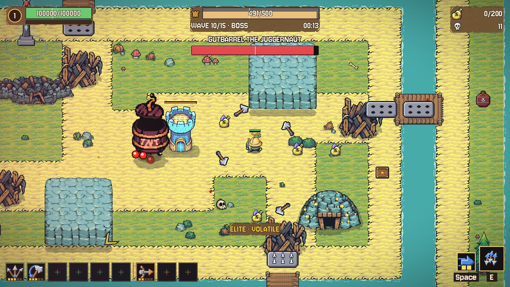
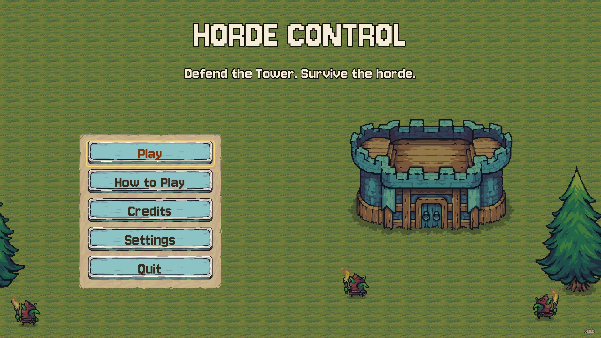
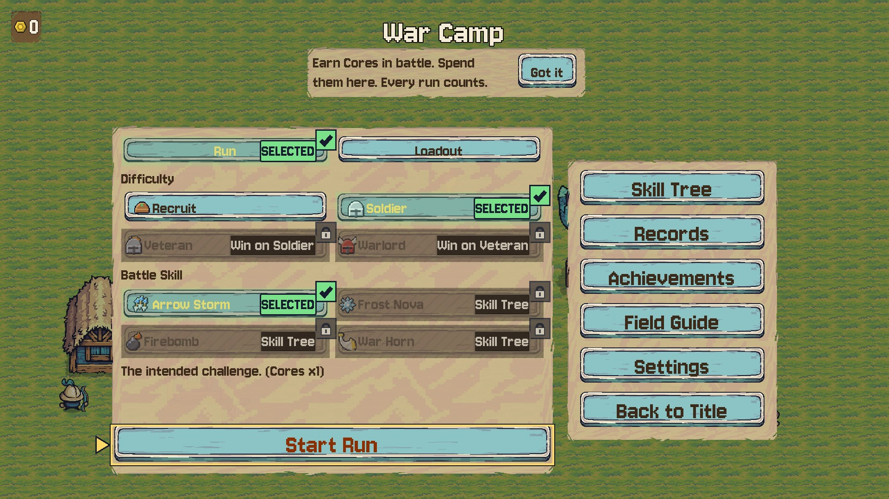
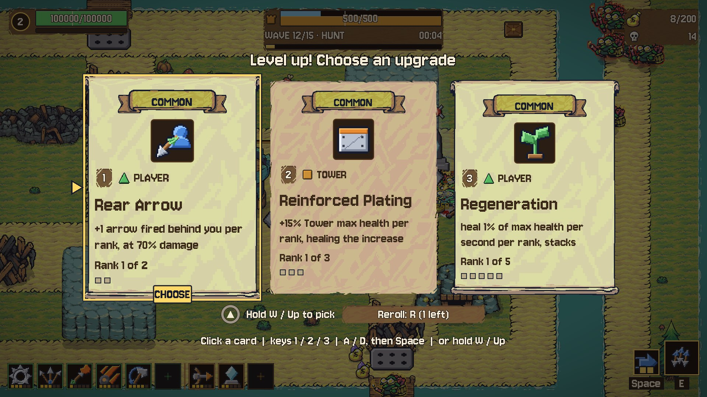
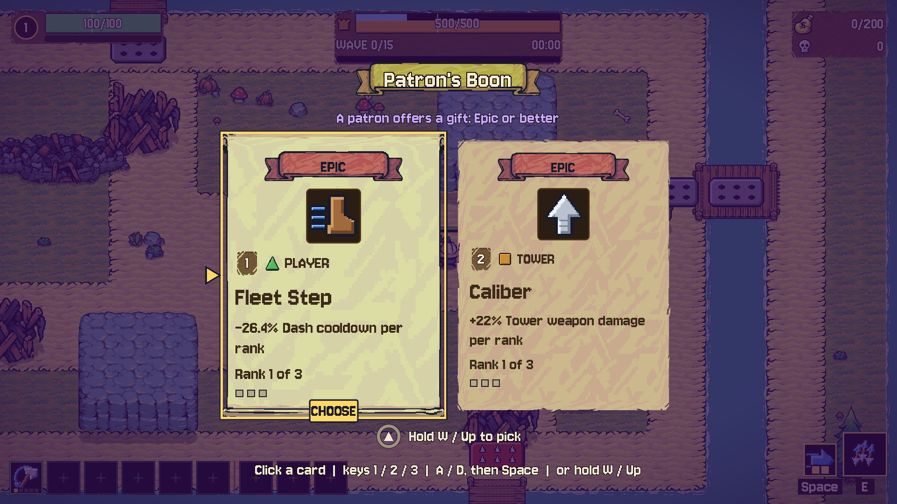
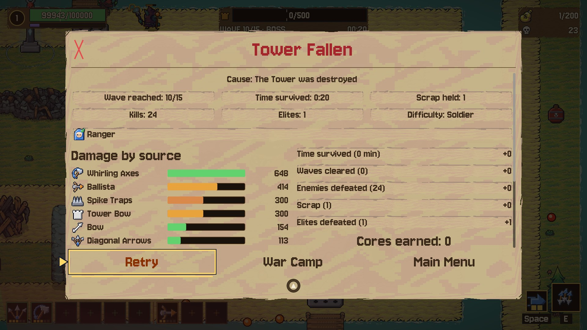

<div align="center">

# Horde Control

**Defend the Tower. Survive the horde.**

A top-down survival roguelite in pixel art. You and a stone Tower stand in the middle of an
island while goblin waves come at both of you. Keep yourself alive, keep the Tower standing,
and spend what each run earns on a permanent skill tree before the next one.

**Windows: download the exe. Android: download the apk. Both are on [Releases](https://github.com/Sayandeep1013/Horde-Control/releases).**



</div>

---

## Screenshots

| Title | War Camp | Level-Up Draft |
|---|---|---|
|  |  |  |

| Patron's Boon | Results |
|---|---|
|  |  |

## How it plays

- **Two things to keep alive.** You and the Tower each have health; if either falls, the run ends.
  Goblins come in swarms. Some go for the Tower, some hunt you, and some switch targets. They get faster every wave.
- **A moated island.** The Tower stands inside a water ring with four bridges. The goblins path around rocks and walls and pour over the bridges.
  Lure them across the spike plates, dash into a powder keg to blow them up, break supply crates, and stand on shrines for short boons.
- **Your bow fires on its own.**
  - You move and **dash** (Space, 2 charges).
  - You fire a **Battle Skill** (E): Arrow Storm, Frost Nova, Firebomb or War Horn.
  - Standing still builds **Focus**, so you shoot faster.
  - Standing by the Tower spends Scrap to **repair** it.
- **Level up mid-fight.** Pick one of three cards. **Abilities** add something new and level up to 5:
  - player abilities, up to 6 at a time: orbiting axes, blade circle, meteor shower, storm bolt, ricochet, diagonal arrows and more;
  - Tower add-ons, up to 3: ballista, catapult, frost ward and more.

  Passives sharpen what you have. Some abilities combo with each other.
- **Run events**, Archero-style:
  - an Opening Pick;
  - a Patron's Boon of Epic cards;
  - a Sanctuary before each boss (heal yourself, repair the Tower, or get stronger);
  - a **Blood Pact** after the first boss, where you choose whether you or the Tower pays for the power.
- **A boss every 5th wave.**
  - The Goblin Warchief, Gutbarrel the Juggernaut and the Bombardier King.
  - They attack in telegraphed patterns of charges, bullet spirals and bomb barrages.
  - Each is open to extra damage for a moment after its big attacks.
  - Kill the King at wave 15 to win.
- **Every run counts.** Cores earned win or lose go into the War Camp:
  - a 30-node **Skill Tree**;
  - 4 **Champions** that change a rule;
  - 8 **Relics**;
  - 19 achievements that unlock new cards.

  Four difficulties, from Recruit to Warlord, and an Endless mode.
- **The Field Guide**, in the War Camp and the pause menu, explains every ability, enemy, boss and arena object. First-time tips explain each new thing as you meet it, and you can switch them off.

Expect to be overwhelmed on your first runs. That is the point: spend your Cores and come back stronger.

## Download (Android)

1. Get `HordeControl-v1.0.0.apk`, attached to the [v1.0.0 release](https://github.com/Sayandeep1013/Horde-Control/releases/tag/v1.0.0), on your phone (later releases carry their own `HordeControl-<tag>.apk`).
2. Open it. Android asks once to allow installs from your browser or file manager; allow it, then install.
3. Play in landscape. Drag on the left half of the screen to move, tap the Dash and Battle Skill buttons on the right, tap a card to pick an upgrade, use the pause button at the top right.

Android 7.0 or newer (the Godot 4.7.1 template's minimum), 64-bit or 32-bit ARM. The app asks for no permissions and never goes online. The APK is built and signed by GitHub Actions from this repository.

## Download (Windows)

1. Get `HordeControl.exe` from the latest [Release](https://github.com/Sayandeep1013/Horde-Control/releases).
2. Run it. No installer.
3. Progress saves to `%APPDATA%\Godot\app_userdata\Horde Control\`.

Windows 10 or 11, 64-bit. Any GPU that runs Vulkan.

## Controls

| Action | Keyboard | Gamepad |
|---|---|---|
| Move | WASD or arrow keys | Left stick |
| Shoot | Automatic | Automatic |
| Dash | Space or Shift | B / LB |
| Battle Skill | E, Q or right mouse | Y / RB |
| Choose an upgrade | A / D or ← / → to move, 1 2 3 to pick directly | D-pad |
| Confirm | Hold Space or Enter, or click | Hold A |
| Reroll the upgrades | R | X |
| Pause | Esc | Start |

Every keyboard binding can be changed in Settings > Controls.

On a phone: drag on the left half of the screen to move (the joystick appears under your thumb), tap a
card to pick it, tap Reroll to reroll, use the pause button at the top right (Android Back also pauses).
To see the touch controls on a desktop, launch with `-- --touch-ui`.

Settings has five tabs:
- **Audio:** master, music, effects and interface volume, mute.
- **Video:** display mode, window size, V-Sync, FPS limit, FPS counter.
- **Gameplay:** auto-cast Battle Skill, damage numbers, screen-shake strength, overhead bars, pause when unfocused, first-time tips, movement-only controls.
- **Controls:** key rebinding.
- **Accessibility:** HUD scale, reduce flashing, enemy outlines.

Settings is reachable from the title screen, the War Camp and the pause menu.

## Building from source

Godot **4.7.1** (standard, not .NET).

```bash
# open the project
godot --path . --editor

# run the tests (gdUnit4, headless)
powershell -File tests/run_tests.ps1 -TestPath "res://tests"

# export the Windows build (export templates 4.7.1 installed)
godot --headless --path . --export-release "Windows Desktop" builds/windows/HordeControl.exe
```

The test suite has about 1,500 cases. One of them, `tests/harness/fail/test_trivial_fail.gd`,
fails on purpose to prove the runner reports failures.

## How it's built

GDScript, no plugins beyond gdUnit4 for tests.

```
src/core/        SimClock, PauseAuthority, EventBus, EntityRegistry, SimLoop: one ordered tick
src/director/    Wave Director and the Pressure Metric: what spawns, where, and when
src/enemy/       goblin intents, Bomber, Brute, Shaman, elites, three bosses, bullet patterns
src/player/      controller, auto-aimed bow, overhead bars
src/tower/       health and shield, weapon, evolution stages
src/upgrade/     the Level-Up Draft pool and effects
src/ability/     abilities, Battle Skills, synergies, Tower repair
src/arena/       crates, kegs, shrines, spike traps, the moated layout
src/navigation/  the FlowField the goblins path with
src/run/         run events (Opening Pick, Patron, Sanctuary, Blood Pact), run config
src/meta/        MetaProgress: save profile, settlement, skill tree, achievements
src/environment/ the island: paths, ponds, plateaus, groves, landmarks
src/ui/          HUD, Draft, War Camp, Skill Tree, menus
```

The design lives in [`MASTER_SDLC.md`](MASTER_SDLC.md) and [`docs/`](docs/): every gameplay number is in
its Provisional Values Register, and every design change has a row in its Review Decision Log.

## Status

| | |
|---|---|
| v1.0.0 | 15-wave campaign plus Endless, 4 difficulties, 3 bosses, 7 enemy types plus elites, 24 abilities and passives, run events, 30-node Skill Tree, Champions and Relics, Windows and Android |
| Next | More balance from playtests, a second biome, performance at the very largest swarms (about 34-45 fps on a laptop at 300+ goblins) |

## Credits

- Art: [Tiny Swords](https://pixelfrog-assets.itch.io/tiny-swords) by Pixel Frog (CC0 edition)
- Music: "Battle Theme A" by cynicmusic, [OpenGameArt](https://opengameart.org/content/battle-theme-a) (CC0)
- Music: "Town Theme RPG" by cynicmusic, [OpenGameArt](https://opengameart.org/content/town-theme-rpg) (CC0)
- Sound effects: project-made (tools/audio/make_sfx.py) and [Kenney](https://kenney.nl) (CC0)
- Font: Jersey 10 by The Soft Type Project Authors (SIL Open Font License 1.1)
- Engine: [Godot](https://godotengine.org) (MIT)

Where every third-party file came from, with hashes: `assets/third_party/*/PROVENANCE.md`.
